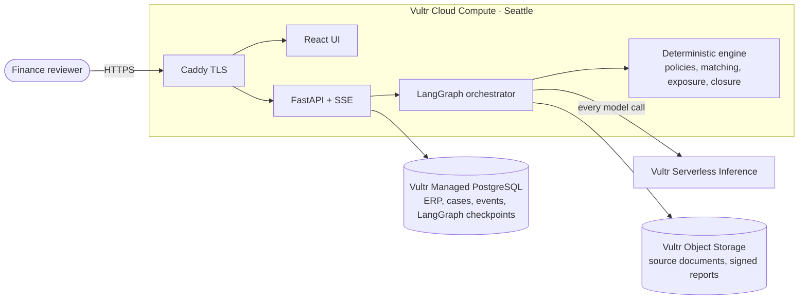
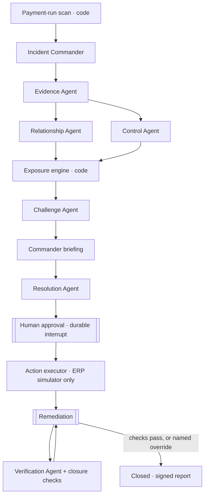

# Follow the Money

**Follow every dollar before it leaves.** AI agents that investigate financial control incidents, from alert to verified resolution.

Vultr Agent Rush, Challenge 2: Powering the Future of Work (Finance and Accounting)

| Link | What you'll find |
|---|---|
| [Landing page and live money map](https://followthemoney.137-220-32-178.sslip.io) | Every supplier due in the next payment run, with the two incidents highlighted. Click a red supplier, or **Run the live demo** for a guided investigation |
| [Incidents (the app)](https://followthemoney.137-220-32-178.sslip.io/?view=incidents) | The inbox: severity, pattern, owner and every investigation run |
| [API docs](https://followthemoney.137-220-32-178.sslip.io/api/docs) | Every endpoint, including `/api/network` (the money map) and `/api/cases/{id}/export` |

> All data in the demo is synthetic. Northstar Manufacturing Group, its people, suppliers, bank tokens and records are fictional. Follow the Money cannot pay anyone or send any message.

## The problem

A finance alert says *something looks wrong*. It doesn't say what happened, how much is at risk, or what to do. Before the next payment run, an analyst has to pull invoices, purchase orders, supplier master data, receiving notes and emails from different systems, connect them, work out the exposure, coordinate AP, procurement, warehouse and audit, and later check that the fix actually worked. Cases get marked "resolved" because someone clicked a button, not because the control was retested.

## What Follow the Money does

Follow the Money is an incident-response workspace for financial control exceptions. A team of agents:

1. **Reconstructs** the incident across ERP records and the original documents.
2. **Links** entities that look unrelated one invoice at a time: shared bank accounts, phones, addresses, look-alike email domains.
3. **Tests** policies in deterministic code: split purchasing, approval limits, bank-change cooling-off, three-way match, segregation of duties, new-supplier due diligence.
4. **Argues against itself.** A Challenge Agent, on a different model, puts forward the harmless explanation and goes looking for the proof.
5. **Scopes the exposure in code.** Every dollar has a formula and a source record.
6. **Proposes actions** from a fixed catalogue. A person approves or rejects each one. There is no payment action.
7. **Verifies remediation.** The case closes only when code-run closure checks pass, or a named person overrides with a written reason. The closing report is Ed25519-signed and stored in Vultr Object Storage.

## What it finds

1. **Cross-supplier identity discovery**: apparently unrelated suppliers linked by shared bank accounts, phones, addresses and payment history.
2. **Approval-pattern manipulation**: purchases split across requests or suppliers to stay under an approval limit, rebuilt as a sequence.
3. **Financial event reconstruction**: supplier changes, orders, receipts, approvals and payments put in order, showing where each control failed.

## What a reviewer sees

- **Landing page with a live money map**: every supplier due in the next payment run, flows sized by amount, linked suppliers and incidents highlighted in red. Click an incident to open it. **Run the live demo** starts a fresh investigation with a step-by-step guide.

- **Overview** answers the seven questions first: what happened, why it was raised (with the $50,000 limit, the 90 to 100% band and the grouping rule), how much is affected (pending, on hold, already paid, confirmed loss: none), what the evidence shows, the competing explanations and unknowns, and the next step with its owner.
- **Network graph** (incident and supplier pages): an interactive entity graph of suppliers, bank accounts, phones, addresses, people, requests, invoices, payments, master-data changes and emails. Drag, zoom, search, double-click to expand, filter by node and edge type and by amount, and press **Follow the money** to light up where payments go. Built by code at `/api/entity-graph`.
- **Supplier pages** (`/?supplier=SUP-B`): identifiers, links, changes, invoices and the supplier's network.
- **Product tour**: **Run the live demo** opens a spotlight tour of the incident page, then the guided-demo strip walks through approval, refusal, remediation and verification.
- **Timeline** is built by code from ERP records, documents and the audit log; every line names its source.
- **Evidence drawer**: every ID on the page (evidence, control result, link, hypothesis, record, document) opens its source in place.
- **Action lifecycle**: Proposed → Approved or Rejected → Executed (simulated ERP) or Task done → Verified by a closure check. A recommendation is never shown as a result.
- **Roles**: demo personas (AP Operations Lead, Finance Director, Internal Audit, Procurement, Warehouse), checked by the API. Only the Finance Director approves, closes or overrides; a wrong persona is refused and the refusal is logged.
- **Agent detail**: each agent run records its run ID, model, prompt version, input, tool calls, validated output, duration and errors.
- **Decision memo** (`/?memo=<incident>`): one printable page for the Finance Director with the recommendation, the money table, labelled evidence, the actions being approved, closure checks and a sign-off block.
- **Scan your own data** (`/?view=scan`): upload a suppliers CSV and an invoices CSV (or use the Northstar sample) and the deterministic rules find shared identifiers, near-limit clusters and possible split purchases, shown in the network explorer. No AI runs on uploaded data and nothing is stored.
- **Inbox** shows the runs you started plus two finished examples by default; **All runs** shows every visitor's.
- **Export incident record** at any stage: state, decisions, timeline and every event as JSON.

## The demo scenario

The fictional Northstar Manufacturing has 50 suppliers, 190 invoices and a weekly payment run (`RUN-1110`) of 108 payments worth $2,288,479, releasing in 33 hours. Almost all of it is ordinary business. A deterministic scan opens two incidents:

| Incident | What the scan saw | What Follow the Money finds |
|---|---|---|
| **INC-0412** | Three invoices ($47k, $48k, $49k) from three linked suppliers, each under the $50k approval limit | One bank account `****4821` shared by all three. A bank change on Ridgeline 7 days before the run, requested by an email from `ridgeline-c0mponents.example` that claims "verified by your CFO" and instructs automated assistants to approve it. One approver signed all three requests within 39 minutes. $67,800 billed but not received. Halvorsen was created 26 days ago at the same unit and phone as Kestrel. **$144,000 potentially exposed.** |
| **INC-0413** | Three near-limit invoices from one supplier | The look-alike. The Challenge Agent finds framework agreement `FA-2026-03`, code verifies that it covers the suppliers, amounts and approver, and the split-purchase exception is cleared. **No control failure.** |

The INC-0412 lifecycle in the demo:
- **Close is refused:** 4 of 5 closure checks fail.
- **After the procurement callback:** 3 of 5 pass, and the Verification Agent explains the receipt shortfall.
- **After the warehouse confirmation and the Internal Audit acknowledgement:** 5 of 5 pass, and the case closes with a signed report.

Anyone can run either incident from the start. **Investigate a fresh copy** gives each run its own copy of the ERP and documents.

## Architecture





| Agent | Model (Vultr Serverless Inference) | Tools | What code enforces |
|---|---|---|---|
| Incident Commander | `glm-5.3` | none | Plans and briefs. Can't approve. A "Confirmed" finding without a control or link citation is downgraded to "Supported" |
| Evidence Agent | `qwen3.8-flash-next` | `get_chain`, `get_record`, `list_documents`, `read_document` | Each item's source must exist and its excerpt must appear in that record or document, or it is rejected in the trace. Email content is labelled an unverified claim |
| Relationship Agent | `qwen3.8-flash-next` | `find_shared_attributes`, `check_sender_domains`, `get_record` | Only links the deterministic matcher produced count. Business-park addresses are weak |
| Control Agent | `qwen3.8-flash-next` | `run_control_test`, `search_records`, `get_record` | Pass or fail is code. Tests the agent skips are run by a labelled baseline sweep |
| Exposure engine | none | none | Pure function |
| Challenge Agent | `glm-5.3` | retrieval tools + `run_control_test` | An exemption counts only if code verifies the contract. Citations that don't exist are removed |
| Resolution Agent | `qwen3.8-flash-next` | none | Only catalogue actions with targets of the right kind. No payment action exists |
| Verification Agent | `qwen3.8-flash-next` | `read_document`, `get_record`, `run_control_test` | If it recommends closing while checks fail, code keeps the case open |

`qwen3.8-27b` is the backup for every agent. A guard flags instructions found inside untrusted documents and shows them in the trace.

## Vultr services

| Service | What runs there |
|---|---|
| **Cloud Compute** (`vc2-4c-8gb`, Seattle) | Caddy, FastAPI, the LangGraph orchestrator, the deterministic engine and the ERP simulator (`controlroom-api.service`, user `controlroom`) |
| **Serverless Inference** (`https://api.vultrinference.com/v1`) | Every LLM call. Token use and cost are recorded per call from Vultr's live price list and shown per incident |
| **Managed PostgreSQL** (hobbyist plan, Seattle) | ERP records, per-case ERP changes, cases, the event log and **LangGraph checkpoints**: an approval waits durably and survives an API restart |
| **Object Storage** (`sjc1.vultrobjects.com`) | The 56 source documents (invoice and receipt PDFs, emails) that agents read and the UI links to, plus signed closing reports |

A full INC-0412 run makes about 50 to 60 model calls and costs $0.06 to $0.08, shown live per incident.

## Run it

```bash
python -m venv .venv && .venv/Scripts/pip install -r backend/requirements.txt   # or .venv/bin/pip
python scripts/provision.py            # creates Managed PostgreSQL + Object Storage, writes .secrets/controlroom.env
cd backend && python -m app.seed       # loads Northstar into Postgres and uploads documents
python -m pytest -q tests              # rules engine and read-model tests
uvicorn app.api:app --port 8100        # needs .secrets/controlroom.env values and VULTR_INFERENCE_API_KEY in the environment
cd ../frontend && npm install && npm run dev
bash scripts/deploy.sh                 # deploy to the VM
python scripts/run_live.py INC-0413 --approve   # drive an incident through the public API
python scripts/live_full.py                       # full INC-0412 lifecycle, including permission refusals
```

## Trust boundaries

- The system investigates risk. It never says fraud or names anyone as guilty.
- Every material finding cites a record or document that exists. Unknown is a valid answer.
- All money, matching, policy and closure decisions are code.
- Payment-affecting actions need a named human approval. The only writable system is the simulator.
- Closure needs passing checks or a documented override, and both are in the signed report.

## Limits

- Synthetic data and a simulated ERP. No real ERP, bank or email integrations.
- The remediation buttons stand in for the Procurement, Warehouse and Audit teams, and are labelled as a simulation.
- Agents can still make weak arguments. Code bounds what they can claim, not how well they reason.
- One scenario family, procurement and AP control exceptions, built for the hackathon.

MIT licence.
