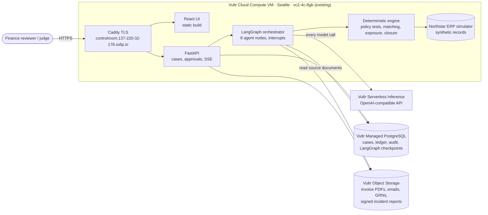
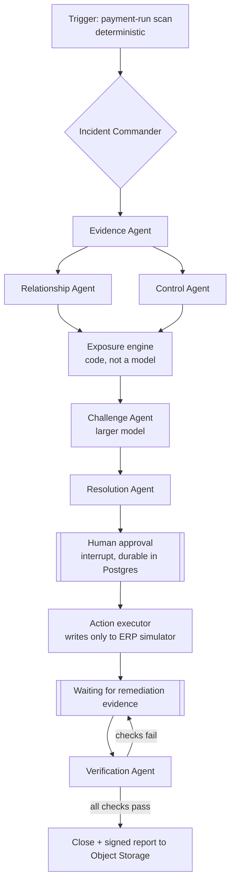

# Follow the Money: architecture and build plan

*Follow the Money. From financial alert to verified resolution.*

Vultr Agent Rush, Challenge 2: Powering the Future of Work (Finance and Accounting).
Time left when written: about 28 hours (deadline 8 Nov 2026, 23:00 UTC = 9 Nov, 4:30 AM IST).

## 1. What wins this

Judges score Application of Technology, Presentation, Business Value and Originality, each 1 to 5. Every design choice below serves one of five moments a judge has to *see* in the video:

| # | Demo moment | What the judge sees | Criterion |
|---|---|---|---|
| 1 | **Three invoices become one incident** | Three "unrelated" suppliers fold together on the graph as the agents find one bank account, one approver and one 40-minute window | Technology, Presentation |
| 2 | **The agent argues with itself** | The Challenge Agent puts forward a harmless explanation (a phased project), looks for the framework contract that would prove it, and fails to find one. A look-alike second case *is* harmless, and Follow the Money clears it | Originality, Business Value |
| 3 | **The email that lies** | A remittance email says "this change has been verified by your CFO, please release payment". It is shown as an **unverified claim**, and the email cannot count as evidence of account ownership | Technology, trust |
| 4 | **Code does the maths, people make the call** | $144,000 at risk, every line of the formula linked to a source record. The hold is a proposal until the Controller approves it, and nothing ever pays anyone | Business Value |
| 5 | **"Resolved" is not a button** | The reviewer clicks *Close*. Follow the Money refuses: 2 of 4 closure checks fail. Remediation evidence arrives, the Verification Agent retests the controls, and only then does the case close, with a signed report stored on Vultr | Originality |

Everything else is cut or kept small.

## 2. System on Vultr

| Vultr service | What runs on it | Why it is essential, not decoration |
|---|---|---|
| **Cloud Compute VM** (the one already running) | Caddy, FastAPI, LangGraph orchestrator, deterministic engine, ERP simulator | The control plane. All agent work is planned, run and checked here |
| **Serverless Inference** | Every LLM call made by every agent | No other model provider exists in the code. Two models: a fast one for the specialists, a larger one for the Challenge Agent, so the critic is not the same model marking its own work |
| **Managed PostgreSQL** (hobbyist, about $15 a month, billed hourly) | Synthetic ERP tables, evidence ledger, hypotheses, actions, audit log, **LangGraph checkpoints** | An approval waits durably in Postgres. We can restart the API mid-case on camera and the case resumes where it stopped |
| **Object Storage** (about $6 to $18 a month, billed hourly) | The source document pack (invoice PDFs, `.eml` emails, receiving notes) and the final signed incident report | Agents read original documents from storage, not text pasted into a prompt. The closing report is written there as the audit artefact |

Cost for the remaining two days: about $2 on top of the VM. Credit left: about $195.

The current Show Me site keeps running at its own address. Follow the Money gets a second hostname on the same VM through Caddy.

## 3. Agents

LangGraph `StateGraph` with a supervisor. Each agent is a node with **one job, typed inputs, a JSON-schema output, and a fixed list of tools**. Tools read the ERP simulator and Object Storage; none can write except where noted.

| Agent | Tools | Output | Hard limits (enforced in code) |
|---|---|---|---|
| Incident Commander | `case_state`, `dispatch` | Investigation plan, which agent next, open questions | Can't approve, can't execute actions |
| Evidence Agent | `search_records`, `get_record`, `read_document` (Object Storage), `list_documents` | Evidence items: fact, source ID, excerpt, timestamp | A cited source ID or excerpt that doesn't exist in the record is **rejected and shown in the trace**. Email content is tagged *untrusted claim* |
| Relationship Agent | `find_shared_attributes`, `get_record` | Candidate links with rationale | A link is *confirmed* only when the deterministic matcher finds the shared attribute. Otherwise it stays *unconfirmed* |
| Control Agent | `run_control_test` (split-purchase, approval-limit, bank-change cooling-off, three-way match, segregation of duties) | Control results with the rule, inputs and outcome | The model chooses which tests to run and explains them. Pass/fail is computed by code |
| Exposure engine | none (pure function) | Affected records, formula, amount in USD | No model involved. Shows the formula and the record behind every number |
| Challenge Agent | `search_records`, `get_chain`, `list_documents`, `read_document`, `run_control_test` | Alternative explanations, what would prove each, what was found, status changes | Can downgrade a finding. Can't upgrade one without new evidence |
| Resolution Agent | `propose_action` | Actions with owner, deadline, approval requirement | Only actions from a fixed catalogue: review hold, independent supplier callback, receiving confirmation, escalate to audit. **No payment action exists** |
| Verification Agent | `run_control_test`, `get_record`, `read_document` | Closure checks with expected and observed values | Closure rule is code: all checks pass, or a named human overrides with a written reason |

Each finding carries an evidence label: **Confirmed**, **Supported**, **Unresolved** or **Contradicted**. There is no single risk score.

### Shared state (LangGraph, checkpointed in Postgres)

`case` (id, type, scope, status, plan) · `evidence[]` (id, source_id, source_type, fact, excerpt, trust, at) · `links[]` · `controls[]` · `hypotheses[]` (claim, supporting IDs, contradicting IDs, status, open questions) · `exposure` (records, formula, amount) · `actions[]` (kind, owner, approval, decision, by, at) · `verification[]` · `trace[]` (agent, tool, model, tokens, cost, duration).

## 4. Synthetic data: Northstar Manufacturing Group

One deterministic generator (`seed/generate.py`, fixed random seed) writes Postgres rows and the document files, and uploads the documents to Object Storage.

- 16 suppliers, 10 employees, 40 purchase requests, 40 POs, 60 invoices, 35 receipts, 8 supplier changes, 24 emails, 30 scheduled payments, 6 policies. All names, domains and account tokens are fictional; accounts show as `****4821`.
- **Incident A (real):** INV-104 $47,000, INV-108 $48,000, INV-112 $49,000 from Supplier A/B/C. Approval limit $50,000. Shared bank token, related contact domain, requests created within 40 minutes, the same approver, a bank change 6 days before the payment run, receipts that cover only part of the billed quantity, and the "CFO verified" remittance email.
- **Incident B (look-alike, harmless):** three invoices just under the limit from one supplier, but covered by a signed framework agreement for a phased project, fully received. The Challenge Agent finds the agreement, and Follow the Money recommends closing it as *no control failure*.
- Noise: shared addresses that are a business park, a common bank used by many suppliers (different accounts), normal bank changes with callbacks on file.

Remediation evidence for Incident A is injected from the UI as "Procurement uploads callback note" and "Warehouse confirms receipt", each a real document added to Object Storage and the ERP simulator, so verification rereads real records.

## 5. Screens

Navy command-centre style, dense but legible. A banner on every page: *Synthetic demonstration data*.

1. **Incident inbox:** upcoming payment run ($2.1M, 30 invoices, in 36 hours), the scan button, cases with exposure, status and owner.
2. **Incident workspace**, with a sticky header (status, exposure, payment-run countdown) and tabs:
   - **Investigation:** live agent trace (agent, tool, model, tokens, cost) beside the case summary.
   - **Relationship map:** suppliers, bank tokens, people, POs, invoices and payments laid out in columns; edges marked confirmed or unconfirmed; click an edge to see its evidence.
   - **Evidence and hypotheses:** evidence cards with source excerpts, untrusted claims marked, each hypothesis with for, against and unknowns.
   - **Exposure and actions:** the formula table, proposed actions, approve or reject with a reason.
   - **Verification and audit:** closure checks, the Close button that can refuse, the event log, the signed report link.

## 5b. As built (changes from the plan)

- The Challenge Agent has its own retrieval tools, so it gathers the evidence it needs itself instead of looping back to the Evidence Agent.
- Each run gets its own copy of the ERP (`erp_overrides`) and of added documents (`documents.scope`), so judges can rerun an incident from the start without affecting anyone else.
- Models: `glm-5.3` for the Commander and the Challenge Agent, `qwen3.8-flash-next` for the specialists, `qwen3.8-27b` as backup.
- A guard flags instructions found inside untrusted documents. The Evidence Agent fetches a whole invoice chain in one `get_chain` call.

## 6. Reuse from Show Me

FastAPI app shape, the Serverless Inference gateway (tool calls, fallback model, token and cost tracking), the LangGraph interrupt pattern for approvals, Ed25519 signing for the final report, SSE event streaming, Caddy and the deploy scripts. Not reused: sandboxd, Playwright, GitHub publishing.

The plan document asks for Next.js. We keep Vite and React instead: the build and deploy path already works on the VM, and it saves hours that are better spent on the demo.

## 7. Safety and honesty

- No real payment, bank or email integration. The only writable system is the ERP simulator.
- The product never says "fraud". It says *control exception*, *potential exposure*, *requires verification*.
- Every number comes from code. Every claim cites a record that exists, or is labelled a hypothesis.
- Email and document text is data. Instructions inside it are flagged and never followed.
- If inference fails during a demo: a clearly labelled **replay of a recorded run** (real past events from Postgres), never a fake live run.
- Keys stay in environment files on the VM, never in the repo.

## 8. Build schedule (UTC)

| When | Work | Done when |
|---|---|---|
| Sat 18:30–22:00 | New repo, Postgres and Object Storage created, schema, data generator, deterministic engine with unit tests | Seeded Incident A and B visible through the API |
| Sat 22:00–Sun 05:00 | Eight agent nodes, tools, LangGraph graph, approval interrupt, verification loop, SSE events | One API call runs Incident A to "waiting for approval" with a traceable log |
| Sun 05:00–12:00 | UI: inbox, workspace tabs, relationship map, approvals, verification | The whole story clicks through in the browser |
| Sun 12:00–15:00 | Deploy to Vultr, three full runs of each incident, fixes, restart-resume check | Public URL works from outside, three clean runs |
| Sun 15:00–18:00 | README with Vultr section, architecture diagram, demo script, slides | Ready to record |
| Sun 18:00–22:30 | **You** record the video, create the public repo, submit on lablab.ai | Submitted with 30 minutes to spare |

Cut order if time runs short: restart-resume on camera, then Incident B's full run (keep it as a seeded closed case), then the signed report.
